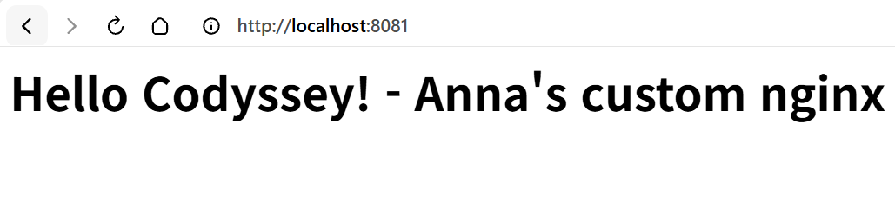
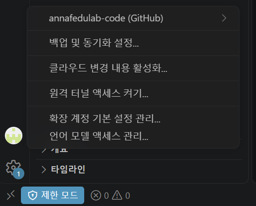
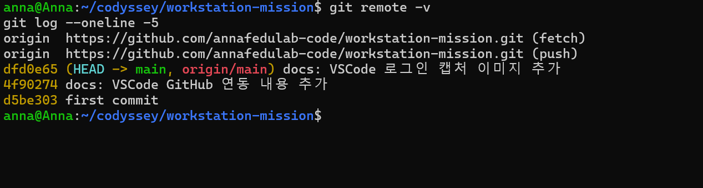

# 내 컴퓨터에 개발자용 '작업실' 꾸미기

## 1. 프로젝트 개요
터미널, Docker, Git/GitHub를 직접 설치하고 사용해 재현 가능한 개발 워크스테이션을 구성하고, 수행 과정을 명령어와 출력 결과로 기록한다.

## 2. 실행 환경
- Host OS: Windows 11 (빌드 26200)
- Linux 환경: WSL2 + Ubuntu 26.04.1 LTS (Kernel 6.18.54.1-microsoft-standard-WSL2)
- Shell: bash
- Docker: 29.9.2 (Docker Engine - Community, WSL Ubuntu 내부 설치)
- Git: 2.53.0 (Ubuntu 내부)

## 3. 수행 체크리스트
- [x] 터미널 기본 조작 및 폴더 구성
- [x] 권한 변경 실습
- [x] Docker 설치/점검
- [x] hello-world / ubuntu 컨테이너 실행
- [x] Dockerfile 커스텀 이미지 빌드/실행
- [x] 포트 매핑 접속 (8080, 8081)
- [x] 바인드 마운트 반영
- [x] 볼륨 영속성
- [x] Git 설정 + VSCode GitHub 연동

## 4. 터미널 조작 로그

### 4-1. 현재 위치 확인, 숨김 파일 포함 목록 확인
```bash
anna@Anna:~$ pwd
/home/anna
anna@Anna:~$ ls -al
total 32
drwxr-x--- 5 anna anna 4096 Nov  2 11:36 .
drwxr-xr-x 3 root root 4096 Nov  2 11:35 ..
-rw-r--r-- 1 anna anna  220 Nov  2 11:35 .bash_logout
-rw-r--r-- 1 anna anna 3771 Nov  2 11:35 .bashrc
drwxr-x--- 4 anna anna 4096 Nov  2 11:36 .cache
drwxr-x--- 3 anna anna 4096 Nov  2 11:36 .config
drwxr-xr-x 2 anna anna 4096 Nov  2 11:36 .landscape
-rw-r--r-- 1 anna anna    0 Nov  2 11:36 .motd_shown
-rw-r--r-- 1 anna anna  807 Nov  2 11:35 .profile
```

### 4-2. 작업 폴더 생성 및 이동
```bash
anna@Anna:~$ mkdir -p ~/codyssey/practice
anna@Anna:~$ cd ~/codyssey/practice
anna@Anna:~/codyssey/practice$ pwd
/home/anna/codyssey/practice
```

### 4-3. 빈 파일 생성
```bash
anna@Anna:~/codyssey/practice$ touch empty.txt
anna@Anna:~/codyssey/practice$ ls -la
total 8
drwxr-xr-x 2 anna anna 4096 Nov  2 12:32 .
drwxr-xr-x 3 anna anna 4096 Nov  2 12:31 ..
-rw-r--r-- 1 anna anna    0 Nov  2 12:32 empty.txt
```

### 4-4. 파일 생성 및 내용 확인
```bash
anna@Anna:~/codyssey/practice$ echo "Hello Codyssey" > hello.txt
anna@Anna:~/codyssey/practice$ cat hello.txt
Hello Codyssey
```

### 4-5. 복사
```bash
anna@Anna:~/codyssey/practice$ cp hello.txt hello_copy.txt
anna@Anna:~/codyssey/practice$ ls -la
total 16
drwxr-xr-x 2 anna anna 4096 Nov  2 12:33 .
drwxr-xr-x 3 anna anna 4096 Nov  2 12:31 ..
-rw-r--r-- 1 anna anna    0 Nov  2 12:32 empty.txt
-rw-r--r-- 1 anna anna   15 Nov  2 12:32 hello.txt
-rw-r--r-- 1 anna anna   15 Nov  2 12:33 hello_copy.txt
```

### 4-6. 이름 변경
```bash
anna@Anna:~/codyssey/practice$ mv hello_copy.txt renamed.txt
anna@Anna:~/codyssey/practice$ ls -la
total 16
drwxr-xr-x 2 anna anna 4096 Nov  2 12:39 .
drwxr-xr-x 3 anna anna 4096 Nov  2 12:31 ..
-rw-r--r-- 1 anna anna    0 Nov  2 12:32 empty.txt
-rw-r--r-- 1 anna anna   15 Nov  2 12:32 hello.txt
-rw-r--r-- 1 anna anna   15 Nov  2 12:33 renamed.txt
```

### 4-7. 다른 폴더로 이동
```bash
anna@Anna:~/codyssey/practice$ mkdir backup
anna@Anna:~/codyssey/practice$ mv renamed.txt backup/
anna@Anna:~/codyssey/practice$ ls -la backup
total 12
drwxr-xr-x 2 anna anna 4096 Nov  2 12:39 .
drwxr-xr-x 3 anna anna 4096 Nov  2 12:39 ..
-rw-r--r-- 1 anna anna   15 Nov  2 12:33 renamed.txt
```

### 4-8. 삭제
```bash
anna@Anna:~/codyssey/practice$ rm backup/renamed.txt
anna@Anna:~/codyssey/practice$ rmdir backup
anna@Anna:~/codyssey/practice$ ls -la
total 12
drwxr-xr-x 2 anna anna 4096 Nov  2 12:39 .
drwxr-xr-x 3 anna anna 4096 Nov  2 12:31 ..
-rw-r--r-- 1 anna anna    0 Nov  2 12:32 empty.txt
-rw-r--r-- 1 anna anna   15 Nov  2 12:32 hello.txt
```

### 4-9. 상대 경로와 절대 경로
```bash
anna@Anna:~/codyssey/practice$ cd ..
anna@Anna:~/codyssey$ pwd
/home/anna/codyssey
anna@Anna:~/codyssey$ cd /home/anna/codyssey/practice
anna@Anna:~/codyssey/practice$ pwd
/home/anna/codyssey/practice
```
- 상대 경로(`..`): 현재 위치를 기준으로 경로를 해석한다. `cd ..`는 한 단계 위 폴더로 이동한다.
- 절대 경로(`/home/...`): 루트(`/`)부터 시작하므로 현재 위치와 관계없이 항상 같은 위치를 가리킨다.

## 5. 권한 실습

### 5-1. 권한 표기 규칙
- `ls -l` 맨 앞 10글자: 첫 글자는 종류(`-` 파일, `d` 디렉토리), 이후 3글자씩 소유자(u) / 그룹(g) / 기타 사용자(o) 권한
- `r`=읽기(4), `w`=쓰기(2), `x`=실행(1, 디렉토리는 진입 권한)
- 숫자 표기는 각 자리의 합: `755` = `rwxr-xr-x`, `644` = `rw-r--r--`, `700` = `rwx------`

### 5-2. 변경 전 상태
```bash
anna@Anna:~/codyssey/practice$ touch script.sh
anna@Anna:~/codyssey/practice$ mkdir secret_dir
anna@Anna:~/codyssey/practice$ ls -l
total 8
-rw-r--r-- 1 anna anna    0 Nov  2 12:32 empty.txt
-rw-r--r-- 1 anna anna   15 Nov  2 12:32 hello.txt
-rw-r--r-- 1 anna anna    0 Nov  2 12:44 script.sh
drwxr-xr-x 2 anna anna 4096 Nov  2 12:44 secret_dir
```

### 5-3. 파일 권한 변경 (644 → 755)
```bash
anna@Anna:~/codyssey/practice$ chmod 755 script.sh
anna@Anna:~/codyssey/practice$ ls -l script.sh
-rwxr-xr-x 1 anna anna 0 Nov  2 12:44 script.sh
```

### 5-4. 디렉토리 권한 변경 (755 → 700)
```bash
anna@Anna:~/codyssey/practice$ chmod 700 secret_dir
anna@Anna:~/codyssey/practice$ ls -ld secret_dir
drwx------ 2 anna anna 4096 Nov  2 12:44 secret_dir
```

### 5-5. 기호 방식 변경 (소유자 쓰기 권한 제거)
```bash
anna@Anna:~/codyssey/practice$ chmod u-w script.sh
anna@Anna:~/codyssey/practice$ ls -l script.sh
-r-xr-xr-x 1 anna anna 0 Nov  2 12:44 script.sh
```

### 5-6. 변경 전/후 비교
| 대상 | 변경 전 | 변경 후 | 사용한 명령 |
|---|---|---|---|
| `script.sh` (파일) | `-rw-r--r--` (644) | `-rwxr-xr-x` (755) → `-r-xr-xr-x` (555) | `chmod 755`, `chmod u-w` |
| `secret_dir` (디렉토리) | `drwxr-xr-x` (755) | `drwx------` (700) | `chmod 700` |

```bash
anna@Anna:~/codyssey/practice$ ls -l
total 8
-rw-r--r-- 1 anna anna    0 Nov  2 12:32 empty.txt
-rw-r--r-- 1 anna anna   15 Nov  2 12:32 hello.txt
-r-xr-xr-x 1 anna anna    0 Nov  2 12:44 script.sh
drwx------ 2 anna anna 4096 Nov  2 12:44 secret_dir
```

## 6. Docker 설치 및 점검

### 6-1. 설치 (공식 설치 스크립트)
```bash
$ curl -fsSL https://get.docker.com -o get-docker.sh
$ sudo sh get-docker.sh
$ sudo usermod -aG docker $USER   # sudo 없이 docker 명령 사용 (터미널 재시작 후 적용)
```

### 6-2. 버전 확인
```bash
anna@Anna:~$ docker --version
Docker version 29.9.2, build a82e528
anna@Anna:~$ git --version
git version 2.53.0
```

### 6-3. 데몬 동작 확인 (`docker info`, 발췌)
```bash
anna@Anna:~$ docker info
Client: Docker Engine - Community
 Version:    29.9.2
 Context:    default
 Plugins:
  buildx: Docker Buildx (Docker Inc.)
    Version:  v0.38.1
  compose: Docker Compose (Docker Inc.)
    Version:  v5.6.1

Server:
 Containers: 0
  Running: 0
  Paused: 0
  Stopped: 0
 Images: 0
 Server Version: 29.9.2
 Storage Driver: overlayfs
 Logging Driver: json-file
 Cgroup Driver: systemd
 Cgroup Version: 2
 Kernel Version: 6.18.54.1-microsoft-standard-WSL2
 Operating System: Ubuntu 26.04.1 LTS
 OSType: linux
 Architecture: x86_64
 CPUs: 14
 Total Memory: 15.38GiB
 Name: Anna
 ID: ****-****(마스킹)
 Docker Root Dir: /var/lib/docker
```
- `Server Version`이 출력되므로 클라이언트가 Docker 데몬(서버)에 정상 연결된 상태임을 확인했다.
- 설치 직후이므로 컨테이너·이미지 수는 0이다.
## 7. Docker 기본 운영 및 컨테이너 실행

### 7-1. hello-world 실행
```bash
anna@Anna:~$ docker run hello-world
Unable to find image 'hello-world:latest' locally
latest: Pulling from library/hello-world
4f55086f7dd0: Pull complete
Status: Downloaded newer image for hello-world:latest

Hello from Docker!
This message shows that your installation appears to be working correctly.
...
```
- 로컬에 이미지가 없으면 Docker Hub에서 자동으로 내려받은 뒤 컨테이너를 생성·실행한다.

### 7-2. 이미지 다운로드 및 목록 확인
```bash
anna@Anna:~$ docker pull ubuntu
Using default tag: latest
latest: Pulling from library/ubuntu
Status: Downloaded newer image for ubuntu:latest
docker.io/library/ubuntu:latest
anna@Anna:~$ docker images
IMAGE                ID             DISK USAGE   CONTENT SIZE   EXTRA
hello-world:latest   c567b231f656       25.9kB         9.49kB    U
ubuntu:latest        6a06111c3b0a        163MB         45.9MB
```

### 7-3. ubuntu 컨테이너 내부 진입 및 명령 실행
```bash
anna@Anna:~$ docker run -it --name my-ubuntu ubuntu bash
root@f05cbf1dca2a:/# ls
bin  boot  dev  etc  home  lib  lib64  media  mnt  opt  proc  root  run  sbin  srv  sys  tmp  usr  var
root@f05cbf1dca2a:/# echo "Hello from container"
Hello from container
root@f05cbf1dca2a:/# exit
exit
```

### 7-4. 컨테이너 목록 확인 (`ps` / `ps -a`)
```bash
anna@Anna:~$ docker ps
CONTAINER ID   IMAGE     COMMAND   CREATED   STATUS    PORTS     NAMES
anna@Anna:~$ docker ps -a
CONTAINER ID   IMAGE         COMMAND    CREATED              STATUS                          PORTS     NAMES
f05cbf1dca2a   ubuntu        "bash"     32 seconds ago       Exited (0) 14 seconds ago                 my-ubuntu
050443e8f7a7   hello-world   "/hello"   About a minute ago   Exited (0) About a minute ago             strange_merkle
```
- `docker ps`는 실행 중인 컨테이너만, `docker ps -a`는 종료된 컨테이너까지 모두 보여준다.

### 7-5. 백그라운드 실행과 exec 진입
```bash
anna@Anna:~$ docker run -d --name keep-ubuntu ubuntu sleep infinity
bf14361923b5f34f1f3e7906d326ed191cf567e39271ba115daab6454b0631bb
anna@Anna:~$ docker ps
CONTAINER ID   IMAGE     COMMAND            CREATED        STATUS                  PORTS     NAMES
bf14361923b5   ubuntu    "sleep infinity"   1 second ago   Up Less than a second             keep-ubuntu
anna@Anna:~$ docker exec -it keep-ubuntu bash
root@bf14361923b5:/# exit
exit
```

### 7-6. 로그 및 리소스 확인
```bash
anna@Anna:~$ docker logs my-ubuntu
root@f05cbf1dca2a:/# ls
bin  boot  dev  etc  home  lib  lib64  media  mnt  opt  proc  root  run  sbin  srv  sys  tmp  usr  var
root@f05cbf1dca2a:/# echo "Hello from container"
Hello from container
root@f05cbf1dca2a:/# exit
exit
anna@Anna:~$ docker stats --no-stream
CONTAINER ID   NAME          CPU %     MEM USAGE / LIMIT     MEM %     NET I/O       BLOCK I/O    PIDS
bf14361923b5   keep-ubuntu   0.00%     2.637MiB / 15.38GiB   0.02%     946B / 126B   0B / 4.1kB   1
```
- `docker logs`로 이미 종료된 `my-ubuntu` 컨테이너의 터미널 출력 기록도 확인할 수 있었다.
- `exec`로 들어갔다가 `exit`한 뒤에도 `docker stats`에 `keep-ubuntu`가 나타나 컨테이너가 계속 실행 중임을 확인했다.

### 7-7. 중지 및 삭제
```bash
anna@Anna:~$ docker stop keep-ubuntu
keep-ubuntu
anna@Anna:~$ docker ps -a
CONTAINER ID   IMAGE         COMMAND            CREATED              STATUS                                PORTS     NAMES
bf14361923b5   ubuntu        "sleep infinity"   About a minute ago   Exited (137) Less than a second ago             keep-ubuntu
f05cbf1dca2a   ubuntu        "bash"             2 minutes ago        Exited (0) 2 minutes ago                        my-ubuntu
050443e8f7a7   hello-world   "/hello"           3 minutes ago        Exited (0) 3 minutes ago                        strange_merkle
anna@Anna:~$ docker rm my-ubuntu keep-ubuntu
my-ubuntu
keep-ubuntu
anna@Anna:~$ docker ps -a
CONTAINER ID   IMAGE         COMMAND    CREATED         STATUS                     PORTS     NAMES
050443e8f7a7   hello-world   "/hello"   3 minutes ago   Exited (0) 3 minutes ago             strange_merkle
```

### 7-8. 관찰 정리: 종료 vs 유지 (run -it / attach vs exec)
| 방식 | 동작 | exit 후 컨테이너 상태 |
|---|---|---|
| `docker run -it ... bash` | bash가 컨테이너의 메인 프로세스(PID 1)로 실행됨 | 메인 프로세스가 끝나므로 **컨테이너 종료** (`Exited (0)`) |
| `docker attach` | 실행 중인 메인 프로세스의 입출력에 연결 | 메인 프로세스를 종료하면 **컨테이너 종료** |
| `docker exec -it ... bash` | 이미 실행 중인 컨테이너에 별도 프로세스를 추가로 실행 | 추가 프로세스만 끝나므로 **컨테이너 유지** (`Up`) |

- 참고: `keep-ubuntu`를 `docker stop`했을 때 종료 코드가 `137`로 표시됐다. `sleep`이 정상 종료 신호(SIGTERM)에 반응하지 않아 Docker가 대기 시간(기본 10초) 후 강제 종료(SIGKILL, 128+9=137)했기 때문이다.
## 8. Dockerfile 커스텀 이미지 및 포트 매핑

### 8-1. 베이스 이미지 선택
- 선택 방식: (A) 웹 서버 베이스 이미지 활용 + 정적 콘텐츠 교체
- 베이스 이미지: `nginx:alpine` (공식 NGINX 이미지의 경량 Alpine Linux 버전)
- 소스 위치: [`my-web/Dockerfile`](my-web/Dockerfile), [`my-web/site/index.html`](my-web/site/index.html)

### 8-2. 웹 페이지 및 Dockerfile 작성 (터미널)
```bash
anna@Anna:~$ mkdir -p ~/codyssey/my-web/site
anna@Anna:~$ cd ~/codyssey/my-web
anna@Anna:~/codyssey/my-web$ cat > site/index.html << 'EOF'
<h1>Hello Codyssey! - Anna's custom nginx</h1>
EOF
anna@Anna:~/codyssey/my-web$ cat > Dockerfile << 'EOF'
FROM nginx:alpine
LABEL org.opencontainers.image.title="anna-custom-nginx"
ENV APP_ENV=dev
COPY site/ /usr/share/nginx/html/
EOF
anna@Anna:~/codyssey/my-web$ cat Dockerfile
FROM nginx:alpine
LABEL org.opencontainers.image.title="anna-custom-nginx"
ENV APP_ENV=dev
COPY site/ /usr/share/nginx/html/
```

### 8-3. 커스텀 포인트와 목적
| 지시어 | 내용 | 목적 |
|---|---|---|
| `FROM` | `nginx:alpine` | 검증된 웹 서버를 가벼운 이미지로 재사용 |
| `LABEL` | `image.title="anna-custom-nginx"` | 이미지 식별용 메타데이터(이름표) 부여 |
| `ENV` | `APP_ENV=dev` | 실행 환경(개발용) 구분을 위한 환경 변수 |
| `COPY` | `site/` → `/usr/share/nginx/html/` | 기본 페이지를 내가 만든 정적 콘텐츠로 교체 |

### 8-4. 빌드
```bash
anna@Anna:~/codyssey/my-web$ docker build -t my-web:1.0 .
[+] Building 6.7s (7/7) FINISHED                                     docker:default
 => [internal] load build definition from Dockerfile                           0.0s
 => [internal] load metadata for docker.io/library/nginx:alpine                2.8s
 => [1/2] FROM docker.io/library/nginx:alpine@sha256:785835ea65db...           2.6s
 => [2/2] COPY site/ /usr/share/nginx/html/                                    0.1s
 => exporting to image                                                         1.0s
 => => naming to docker.io/library/my-web:1.0                                  0.0s
anna@Anna:~/codyssey/my-web$ docker images
IMAGE                ID             DISK USAGE   CONTENT SIZE   EXTRA
hello-world:latest   c567b231f656       25.9kB         9.49kB    U
my-web:1.0           0f45ffb1eb61       93.6MB         26.3MB
ubuntu:latest        6a06111c3b0a        163MB         45.9MB
```

### 8-5. 포트 매핑 실행 및 접속 (8080)
```bash
anna@Anna:~/codyssey/my-web$ docker run -d -p 8080:80 --name my-web-8080 my-web:1.0
b41046f008e97d024e46b191469c84443029be996a6ed4146cce12c6b0201b7a
anna@Anna:~/codyssey/my-web$ docker ps
CONTAINER ID   IMAGE        COMMAND                  CREATED        STATUS                  PORTS                                     NAMES
b41046f008e9   my-web:1.0   "/docker-entrypoint.…"   1 second ago   Up Less than a second   0.0.0.0:8080->80/tcp, [::]:8080->80/tcp   my-web-8080
anna@Anna:~/codyssey/my-web$ curl http://localhost:8080
<h1>Hello Codyssey! - Anna's custom nginx</h1>
```


### 8-6. 같은 이미지를 다른 포트로 실행 (8081)
```bash
anna@Anna:~/codyssey/my-web$ docker run -d -p 8081:80 --name my-web-8081 my-web:1.0
150ac7c42ce67f9ae4469f37c3d8ed089a42e8c8460fdb2a8aeadebf71d71a11
anna@Anna:~/codyssey/my-web$ curl http://localhost:8081
curl: (56) Recv failure: Connection reset by peer
```
- 실행 직후 `curl`은 실패했으나, 잠시 후 브라우저 접속은 성공했다. ([트러블슈팅 2](#트러블슈팅-2-curl-56-recv-failure-connection-reset-by-peer) 참고)



### 8-7. 포트 매핑이 필요한 이유
- 컨테이너는 격리된 네트워크를 가지므로, 컨테이너 내부의 80번 포트는 그대로는 호스트에서 접근할 수 없다.
- `-p <호스트 포트>:<컨테이너 포트>`로 호스트의 포트를 컨테이너 포트에 연결해야 외부(브라우저)에서 접속할 수 있다.
- 같은 이미지라도 호스트 포트만 다르게(8080, 8081) 지정하면 여러 컨테이너를 동시에 실행할 수 있다.
## 9. 바인드 마운트 및 볼륨 영속성

### 9-1. 바인드 마운트: 호스트 변경 사항 즉시 반영
```bash
anna@Anna:~/codyssey/my-web$ docker run -d -p 8082:80 -v ~/codyssey/my-web/site:/usr/share/nginx/html --name my-web-bind nginx:alpine
Unable to find image 'nginx:alpine' locally
alpine: Pulling from library/nginx
Status: Downloaded newer image for nginx:alpine
2ec831f8b90f8908e9b7a142b9b84319d267204f0fab3b30ae1bf23dbe0459ec

# 변경 전
anna@Anna:~/codyssey/my-web$ curl http://localhost:8082
<h1>Hello Codyssey! - Anna's custom nginx</h1>

# 호스트에서 파일 수정
anna@Anna:~/codyssey/my-web$ echo "<h1>Bind mount updated!</h1>" > site/index.html
anna@Anna:~/codyssey/my-web$ cat site/index.html
<h1>Bind mount updated!</h1>

# 변경 후 (컨테이너 재시작/재빌드 없음)
anna@Anna:~/codyssey/my-web$ curl http://localhost:8082
<h1>Bind mount updated!</h1>

# 원래 내용으로 복구
anna@Anna:~/codyssey/my-web$ echo "<h1>Hello Codyssey! - Anna's custom nginx</h1>" > site/index.html
```
| 시점 | `curl http://localhost:8082` 응답 |
|---|---|
| 변경 전 | `Hello Codyssey! - Anna's custom nginx` |
| 호스트 파일 수정 후 | `Bind mount updated!` |

- 이미지에 파일을 복사(`COPY`)한 8080/8081 컨테이너와 달리, 바인드 마운트는 호스트 폴더를 그대로 연결하므로 재빌드 없이 변경이 바로 반영된다.

### 9-2. Docker 볼륨: 컨테이너 삭제 후에도 데이터 유지
```bash
# 볼륨 생성 및 연결
anna@Anna:~/codyssey/my-web$ docker volume create mydata
mydata
anna@Anna:~/codyssey/my-web$ docker volume ls
DRIVER    VOLUME NAME
local     mydata
anna@Anna:~/codyssey/my-web$ docker run -d --name vol-test -v mydata:/data ubuntu sleep infinity
5507ea3886f6f6bc54e31e8149e5c12a1177843d5fdc7ba83da877e01211616b

# 볼륨에 데이터 저장
anna@Anna:~/codyssey/my-web$ docker exec vol-test bash -c "echo hi > /data/hello.txt && cat /data/hello.txt"
hi

# 컨테이너 삭제
anna@Anna:~/codyssey/my-web$ docker rm -f vol-test
vol-test
anna@Anna:~/codyssey/my-web$ docker ps -a
CONTAINER ID   IMAGE          COMMAND                  CREATED              STATUS                      PORTS                                     NAMES
2ec831f8b90f   nginx:alpine   "/docker-entrypoint.…"   About a minute ago   Up About a minute           0.0.0.0:8082->80/tcp, [::]:8082->80/tcp   my-web-bind
150ac7c42ce6   my-web:1.0     "/docker-entrypoint.…"   9 minutes ago        Up 9 minutes                0.0.0.0:8081->80/tcp, [::]:8081->80/tcp   my-web-8081
b41046f008e9   my-web:1.0     "/docker-entrypoint.…"   9 minutes ago        Up 9 minutes                0.0.0.0:8080->80/tcp, [::]:8080->80/tcp   my-web-8080
050443e8f7a7   hello-world    "/hello"                 17 minutes ago       Exited (0) 17 minutes ago                                             strange_merkle

# 새 컨테이너에 같은 볼륨 연결 후 확인
anna@Anna:~/codyssey/my-web$ docker run -d --name vol-test2 -v mydata:/data ubuntu sleep infinity
692af466a5a261826268f72bb86b9e15f93a42b8302b44d757ab715e0138b9ac
anna@Anna:~/codyssey/my-web$ docker exec vol-test2 bash -c "cat /data/hello.txt"
hi

# 정리
anna@Anna:~/codyssey/my-web$ docker rm -f vol-test2 my-web-bind
vol-test2
my-web-bind
```
| 시점 | 컨테이너 | `/data/hello.txt` |
|---|---|---|
| 삭제 전 | `vol-test` | `hi` |
| 삭제 후 새 컨테이너 | `vol-test2` | `hi` (유지됨) |

- 컨테이너 내부 파일시스템은 컨테이너를 삭제하면 함께 사라지지만, 볼륨은 Docker가 컨테이너와 별도로 관리하므로 데이터가 남는다. DB 데이터처럼 보존해야 하는 정보는 볼륨에 저장한다.

## 10. Git 설정 및 GitHub 연동

### 10-1. Git 사용자 정보 및 기본 브랜치 설정
```bash
anna@Anna:~/codyssey/my-web$ git config --global user.name "Anna"
anna@Anna:~/codyssey/my-web$ git config --global user.email "a****@gmail.com"
anna@Anna:~/codyssey/my-web$ git config --global init.defaultBranch main
anna@Anna:~/codyssey/my-web$ git config --list
user.name=Anna
user.email=a****@gmail.com
init.defaultbranch=main
```
- 이메일은 개인정보 보호를 위해 마스킹했다.

### 10-2. VSCode GitHub 로그인 및 저장소 연동
- VSCode 계정 메뉴에서 GitHub 계정(`annafedulab-code`) 로그인 상태를 확인했다.



- WSL Ubuntu의 `~/codyssey/workstation-mission` 폴더를 VSCode로 열고(`code .`, 하단 표시 `WSL: Ubuntu`), 소스 제어 패널의 **Publish to GitHub**로 원격 저장소를 생성해 첫 커밋을 올렸다.
- 원격 저장소: https://github.com/annafedulab-code/workstation-mission
- 참고: VSCode가 "제한 모드"이면 소스 제어(Git) 기능이 비활성화되어 Publish 버튼이 보이지 않으므로, 폴더를 신뢰(Trust)한 뒤 진행했다.

### 10-3. Git과 GitHub의 차이
- Git: 내 컴퓨터(로컬)에서 파일 변경 이력을 기록·관리하는 버전 관리 도구
- GitHub: Git 저장소를 인터넷(원격)에 올려 공유·백업·협업할 수 있게 해 주는 플랫폼

### 10-4. 원격 저장소 연결 및 push 증거
- 원격 저장소 연결 확인 및 최근 커밋 로그
```bash
anna@Anna:~/codyssey/workstation-mission$ git remote -v
origin  https://github.com/annafedulab-code/workstation-mission.git (fetch)
origin  https://github.com/annafedulab-code/workstation-mission.git (push)
anna@Anna:~/codyssey/workstation-mission$ git log --oneline -5
dfd0e65 (HEAD -> main, origin/main) docs: VSCode 로그인 캡처 이미지 추가
4f90274 docs: VSCode GitHub 연동 내용 추가
d5be303 first commit
```



- `origin`이 GitHub 저장소 주소로 fetch/push 모두 연결되어 있다.
- 최신 커밋에 `HEAD -> main`과 `origin/main`이 함께 표시되어, 로컬 main의 최신 커밋이 원격(origin/main)까지 push된 상태임을 확인했다.
- GitHub에 push된 커밋 히스토리: https://github.com/annafedulab-code/workstation-mission/commits/main

| 커밋 | 메시지 | 일시(KST) | push 방법 |
|---|---|---|---|
| [`d5be303`](https://github.com/annafedulab-code/workstation-mission/commit/d5be30327e7df0dafb35d1d92f1b39915fbd7b7b) | first commit | 2026-11-02 13:39 | VSCode "Publish to GitHub" |
| [`4f90274`](https://github.com/annafedulab-code/workstation-mission/commit/4f902746f20a5744e0ea786a83ca474762b0fb9a) | docs: VSCode GitHub 연동 내용 추가 | 2026-11-04 12:56 | VSCode 소스 제어 "동기화" |
| [`dfd0e65`](https://github.com/annafedulab-code/workstation-mission/commit/dfd0e65c84fb727803ff62aed041cde568a2ddef) | docs: VSCode 로그인 캡처 이미지 추가 | 2026-11-04 13:35 | VSCode 소스 제어 "동기화" |

- 로컬에서 만든 커밋이 위 GitHub 커밋 링크에 그대로 나타나므로, 원격 저장소로 push가 성공했음을 확인할 수 있다.

## 11. 트러블슈팅

### 트러블슈팅 1: `mv: cannot stat 'renamed.txt': No such file or directory`
- 문제: 파일을 `backup/` 폴더로 옮기는 중 위 오류가 발생했고, 이어서 `rm backup/renamed.txt`도 같은 이유로 실패했다.
```bash
anna@Anna:~/codyssey/practice$ mv renamed.txt backup/
mv: cannot stat 'renamed.txt': No such file or directory
anna@Anna:~/codyssey/practice$ rm backup/renamed.txt
rm: cannot remove 'backup/renamed.txt': No such file or directory
```
- 원인 가설: 옮기려는 `renamed.txt` 파일이 현재 폴더에 존재하지 않는다.
- 확인: `ls -la` 결과 `renamed.txt`는 없고 `hello_copy.txt`만 있었다. 이름 변경 단계(`mv hello_copy.txt renamed.txt`)를 빠뜨린 것을 확인했다.
- 해결: 이름 변경 명령을 먼저 실행한 뒤 이동/삭제를 다시 수행해 정상 동작을 확인했다. (4-6 ~ 4-8 로그 참고)
- 배운 점: 명령 실행 전 `ls`로 대상 파일이 실제로 있는지 확인하는 습관이 필요하다.

### 트러블슈팅 2: `curl: (56) Recv failure: Connection reset by peer`
- 문제: `my-web-8081` 컨테이너를 실행한 직후 `curl http://localhost:8081`이 연결 재설정 오류로 실패했다. 같은 이미지의 8080 컨테이너는 정상 응답했다.
- 원인 가설: 컨테이너는 생성됐지만 내부 nginx가 아직 요청을 받을 준비를 마치기 전에 `curl`을 바로 보냈다. (명령을 여러 줄 한꺼번에 붙여넣어 `run` 직후 지연 없이 실행됨)
- 확인: 잠시 후 브라우저로 `http://localhost:8081`에 접속하니 페이지가 정상 표시됐다. 이후 같은 명령을 다시 실행하자 정상 응답했다.
```bash
anna@Anna:~/codyssey/my-web$ curl http://localhost:8081
<h1>Hello Codyssey! - Anna's custom nginx</h1>
```
- 해결/대안: 컨테이너 실행 후 `docker ps`로 상태를 확인하고 1~2초 뒤 접속한다. 필요하면 `docker logs my-web-8081`로 nginx 시작 로그를 확인한다.

### 트러블슈팅 3: 프롬프트가 `>`로 바뀌고 명령이 실행되지 않음
- 문제: `git config` 명령을 붙여넣었는데 아무 결과 없이 프롬프트가 `>`로 바뀌고 입력만 계속 받았다.
```bash
anna@Anna:~/codyssey/my-web$ /' git config --global user.name "Anna"
git config --global user.email "a****@gmail.com"
> /' git config --global user.name "Anna"
git config --global user.email "a****@gmail.com"
^C
```
- 원인 가설: 복사 과정에서 명령 앞에 `/'`가 딸려 들어가, 셸이 닫히지 않은 작은따옴표(`'`)의 끝을 기다리고 있었다.
- 확인: 입력 줄 맨 앞에 `/'`가 붙어 있었고, `>`는 bash의 줄 이어 입력(PS2) 프롬프트임을 확인했다.
- 해결: `Ctrl+C`로 입력을 취소한 뒤 명령을 한 줄씩 다시 입력해 정상 설정했다. (10-1 참고)
